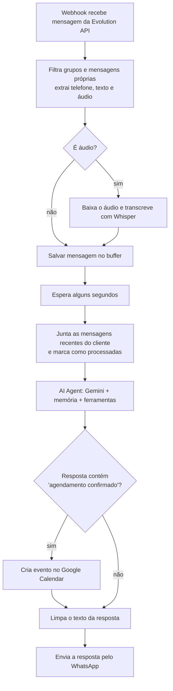

# Bot de agendamento para barbearia (WhatsApp + IA + n8n)

Atendente virtual que conversa com clientes pelo WhatsApp, entende o que eles querem (serviços, horários, agendar, cancelar), grava os agendamentos em um banco PostgreSQL e cria o evento no Google Calendar.

Projeto desenvolvido em dupla, como estudo de automação com IA e banco de dados. Foi usado como protótipo (instância de teste), **ainda não é um sistema pronto para produção**: veja a seção [Limitações conhecidas](#limitações-conhecidas).

## O que ele faz

- Responde dúvidas sobre serviços e preços (lidos do banco, não escritos no prompt).
- Mostra horários livres de um dia e cria o agendamento.
- Cancela agendamentos.
- Entende mensagens de **áudio** (transcreve com Whisper, via Groq).
- Junta mensagens enviadas em sequência ("oi", "quero", "um corte") em um único texto antes de responder.
- Lembra do contexto da conversa (memória no PostgreSQL).
- Cria o evento no Google Calendar quando o agendamento é confirmado.

## Tecnologias

| Parte | Ferramenta |
|---|---|
| Automação / fluxo | n8n |
| Banco de dados | PostgreSQL |
| IA (agente) | Google Gemini 2.5 Flash |
| WhatsApp | Evolution API |
| Transcrição de áudio | Groq (Whisper large-v3) |
| Agenda | Google Calendar |

## Como o fluxo funciona



### Ferramentas do agente

| Ferramenta | O que faz |
|---|---|
| `ver_servicos` | Lista serviços ativos com preço e duração |
| `ver_horarios_disponiveis` | Horários livres de uma data (intervalos de 15 min) |
| `criar_agendamento` | Grava o agendamento no banco |
| `cancelar_agendamento` | Marca o agendamento como cancelado |
| `ver_meus_agendamentos` | Consulta de agendamentos do cliente (veja as limitações) |
| `data_hora_atual` | Data e hora de Brasília, para o agente não marcar no passado |
| `Calculator` | Cálculo de valores |

## Banco de dados

O arquivo [`schema.sql`](schema.sql) cria três tabelas:

- **`servicos`**: nome, descrição, preço, duração e se está ativo.
- **`agendamentos`**: telefone, nome, serviço, `data_hora` (com fuso) e `status` (`confirmado` ou `cancelado`).
- **`mensagens_buffer`**: mensagens recebidas, usadas para agrupar mensagens em sequência.

Um índice único impede **dois agendamentos confirmados no mesmo horário**, mesmo que duas pessoas peçam ao mesmo tempo. Agendamentos cancelados não bloqueiam o horário.

A memória da conversa (`n8n_chat_histories`) é criada automaticamente pelo n8n.

## Como rodar

**1. Banco de dados**

```bash
psql -v ON_ERROR_STOP=1 -d seu_banco -f schema.sql
```

Depois, cadastre seus serviços reais na tabela `servicos` e fixe o fuso do banco (as consultas de horários livres dependem disso):

```sql
ALTER DATABASE seu_banco SET timezone TO 'America/Sao_Paulo';
```

**2. Variáveis de ambiente do n8n**

| Variável | Para quê |
|---|---|
| `EVOLUTION_API_URL` | Endereço da sua Evolution API |
| `EVOLUTION_API_KEY` | Chave da Evolution API |
| `GROQ_API_KEY` | Chave da Groq (transcrição de áudio) |

> Nenhuma chave está no repositório. Nunca coloque chaves direto no workflow; use variáveis ou as *Credentials* do n8n.

**3. Importar o workflow**

1. No n8n, importe `Barbearia_bot_agendamento.json`.
2. Selecione as credenciais: **Postgres**, **Google Gemini** e **Google Calendar (OAuth2)**.
3. No node `Create an event`, troque `seu-email@gmail.com` pelo ID da sua agenda.
4. Nos nodes que chamam a Evolution API, ajuste o nome da instância (no exemplo: `Barbearia apenas teste`).
5. Ative o workflow.

**4. Evolution API**

Aponte o webhook da sua instância para `https://SEU_N8N/webhook/barbearia-teste` (método POST, evento de mensagens recebidas).

## Limitações conhecidas

Este projeto é um protótipo. Estas são as falhas que encontrei ao revisá-lo, anotadas aqui de propósito:

**Agendamentos**
- **Cancelar por telefone:** a ferramenta `cancelar_agendamento` filtra só pelo telefone, então pode cancelar *todos* os agendamentos daquele cliente, não apenas o escolhido. O correto seria cancelar por `id` + telefone.
- **Duração não é considerada no conflito:** o índice único bloqueia apenas horários de início idênticos. Um serviço de 45 minutos não impede um agendamento começando 15 minutos depois.
- **`ver_meus_agendamentos` está errada:** a consulta usada nessa ferramenta devolve horários livres, não os agendamentos do cliente.
- **Regras só no prompt:** horário de funcionamento e antecedência mínima são instruções para a IA; o banco não as impõe, então a IA pode errar.
- **Horários livres vão até 18h:** a consulta gera horários das 9h às 18h, enquanto o prompt diz que a barbearia fecha às 20h.

**Google Calendar**
- O evento sempre dura 1 hora, independentemente do serviço.
- Ao cancelar um agendamento, o evento do Calendar **não** é apagado.
- A criação do evento depende de a resposta da IA conter o texto "agendamento confirmado", o que é frágil.

**Robustez e segurança**
- **Webhook sem autenticação:** quem descobrir a URL pode enviar mensagens falsas. Em uso real, proteja com um header secreto.
- **Mensagens podem se perder:** só as mensagens dos últimos 10 segundos são enviadas à IA, e as pendentes são marcadas como processadas *antes* de a IA responder. Se algo falhar no meio, a mensagem não é refeita.
- **Sem proteção contra mensagem duplicada:** o `messageId` é lido, mas não é usado para evitar processar a mesma mensagem duas vezes.
- **Sem reenvio:** se o WhatsApp falhar ao enviar a resposta, o fluxo não tenta de novo.
- **Limpeza da resposta:** o código remove tudo que estiver entre chaves `{ }` no texto da IA, o que pode apagar trechos legítimos.

## O que ainda deve ser corrigido

- [ ] Cancelar por `id` do agendamento.
- [ ] Corrigir a ferramenta `ver_meus_agendamentos`.
- [ ] Considerar a duração do serviço ao checar conflitos de horário.
- [ ] Duração real do evento no Google Calendar e exclusão ao cancelar.
- [ ] Autenticação no webhook.
- [ ] Evitar mensagens duplicadas usando o `messageId`.

## Uso de IA

Usamos ferramentas de IA durante o projeto, principalmente para
escrever e revisar o SQL do banco de dados e para aprender como
estruturar o agente no n8n. As decisões do projeto, a montagem do
fluxo e os testes foram feitos por nós, e a revisão do código
(incluindo as limitações listadas acima) também.

## Autores

- Ártus Alves: [GitHub](https://github.com/artus-prog)
